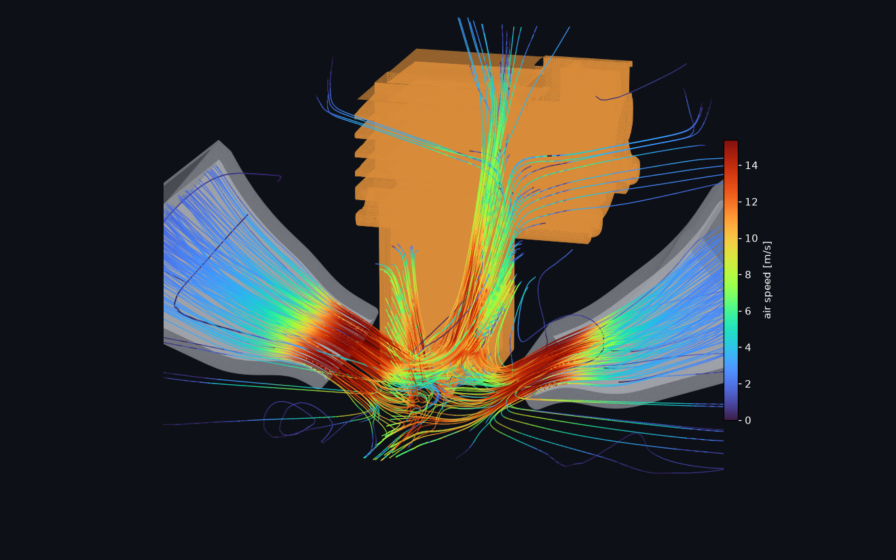
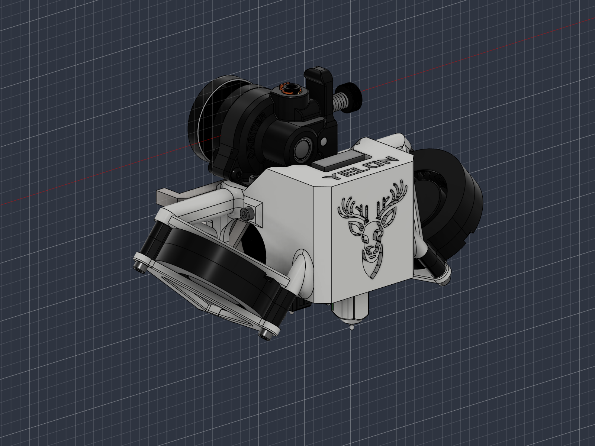

# GeeeTech A10M – Yelon Frankenstein Build

Mods for the **Geeetech A10M**.

## Toolhead: Bambu-style hotend + Orbiter v2 → [toolhead-bambu-orbiter](toolhead-bambu-orbiter/)

**[▶ Open the rotatable 3D airflow model](https://akinzou.github.io/GeeeTech-A10M-Yelon-FrankensteinBuild/)**. Each fan's jet can be
switched on and off in the legend.

The toolhead carries a direct-drive Bambu P1S/X1-style hotend, an Orbiter v2.0, 2× 5015 part-cooling fans, a BLTouch and an
ADXL345. It runs on an MGN12H X rail. The cooling ducts were designed with CFD and the whole head was checked with vibration FEA.

- **Cooling:** with nothing under the nozzle (thin walls, bridges), air just below it is about 2.2× faster than with the stock ducts. Near the bed it is +43 % faster. The jets no longer hit the silicone sock.
- **Stiffness:** the first fan vibration mode moved from 135 Hz to 156 Hz (ASA) / 168 Hz (ASA-CF), out of Klipper's test band.
- **Mounting:** the ducts are screwed to the fans instead of glued.

STEP/STL files, photos and results: **[toolhead-bambu-orbiter](toolhead-bambu-orbiter/)**.

Licence: [CC BY-SA 4.0](LICENSE). Bought parts (hotend, extruder, fans, probe, boards, rail) belong to their makers; their CAD files
are not included.
