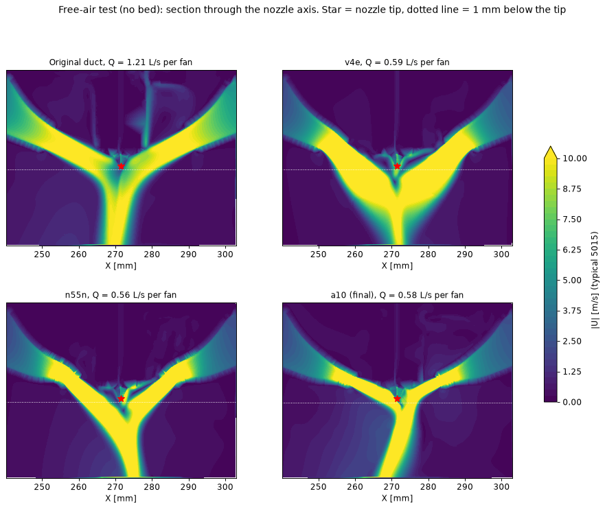
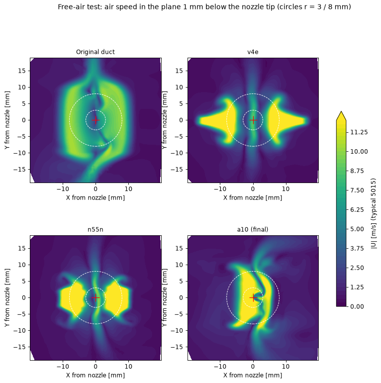

# Part-cooling airflow (CFD)

[▶ Rotatable 3D model of the final ducts](https://akinzou.github.io/GeeeTech-A10M-Yelon-FrankensteinBuild/)

The final **a10** ducts aim both jets at a point **1 mm below the nozzle tip**.

| Typical 5015 fan | Stock | **a10** |
|---|---|---|
| Flow per fan | 1.23 L/s | 0.57 L/s |
| No bed, 1 mm below the tip, r < 3 mm | 4.7 m/s | **10.5 m/s** |
| No bed, downward speed under the tip | +3.1 m/s | **+5.2 m/s** |
| With bed, 1 mm above it, r 0–3 / 3–8 / 8–15 mm | 2.4 / 4.7 / 6.3 m/s | **3.4 / 6.7** / 5.3 m/s |
| Jet on the silicone sock | direct hit | none (−91 % wall shear) |

*r* is the distance from the nozzle axis. The trade-off is that the narrow outlet has about 9× the resistance, so each fan delivers about
half the air, and less of it reaches beyond 10–15 mm.

## How the design got there

1. **Stock:** the jets hit the silicone sock and land 12–15 mm from the nozzle.
2. **45° visor:** the jets land closer, giving +20–25 % near the nozzle, but the sock is still hit.
3. **v4e, outlet narrowed to 10 mm:** about +125 % near the nozzle with a bed. Without a bed, however, the jets cross 5–8 mm below the nozzle and the air rises under the tip.
4. **n55n, 55° snout:** the same problem as v4e.
5. **a10, aimed snout** (16 × 2.5 mm exit at 26.7°, about 2.4 mm above the tip):
   - one clean downward column just under the nozzle;
   - +43 % with a bed;
   - at least 3.4 mm from the sock.

## Model

- **Solver:** OpenFOAM v2412, steady k-ω SST, 2.9 M cells (with bed) or 4.7 M cells (free air).
- **Fans:** uniform inflow at each 5015 outlet, scaled to the operating point of a typical no-name 5015 (linear curve, 2.0 L/s / 170 Pa).
- **Bed:** 0.5 mm below the tip. In the free-air case the domain is open 50 mm below.

## Limitations

- Simulated before the stiffening, the duct ears and the diagonals. The right diagonal covers about 24 % of the right fan's inlet; this was not modelled.
- No heat transfer. The nozzle tip gets more air than before, so re-run PID tuning with the part fan on.
- Fan modelled as a uniform plug with a linear curve; real no-name fans vary a lot.
- The merged jet sits 2–4 mm towards −X. This is most likely the steady solver picking a side.
- Some comparison cases ran 350 iterations; 350 vs 700 differed by < 1 %.
- Not measured yet.
