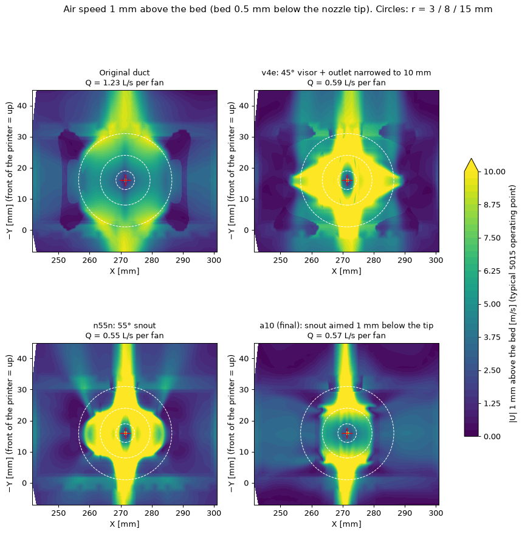
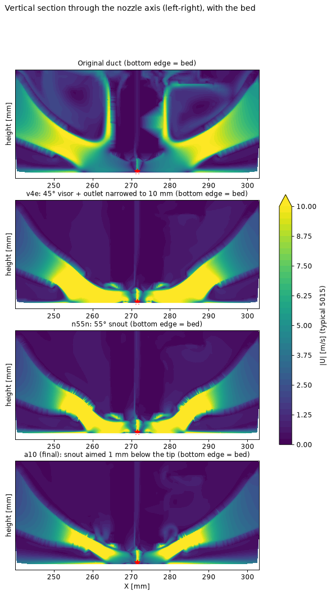

# Part-cooling airflow (CFD)

This study redesigned the outlets of the two 5015 part-cooling ducts. The final duct is called **a10**. Its snout aims both jets
at a point **1 mm below the nozzle tip**, and the air reaches the nozzle from both sides.

All numbers below come from steady RANS simulations. Nothing here has been checked against a print or a measurement yet. See
[Limitations](#limitations).

## Summary

| at the typical 5015 operating point | Original duct | **a10 (final)** |
|---|---|---|
| Flow per fan | 1.23 L/s | 0.57 L/s |
| **Free air** (no bed), mean speed 1 mm below the tip, r < 3 mm | 4.7 m/s | **10.5 m/s (×2.2)** |
| Free air, mean speed 1 mm below the tip, r 3–8 mm | 7.7 m/s | 7.8 m/s |
| Free air, mean speed 1 mm below the tip, r 8–15 mm | 6.9 m/s | 2.6 m/s |
| Free air, downward velocity under the tip (r < 3 mm) | +3.1 m/s | **+5.2 m/s** |
| **With bed** (0.5 mm under the tip), speed 1 mm above the bed, r 0–3 mm | 2.39 m/s | **3.40 m/s (+42 %)** |
| With bed, r 3–8 mm | 4.70 m/s | **6.72 m/s (+43 %)** |
| With bed, r 8–15 mm | 6.32 m/s | 5.30 m/s (−16 %) |
| Jet hitting the silicone sock (wall shear on the sock sides, qualitative) | reference | −91 % (no direct hit) |
| Wall shear on the nozzle tip (qualitative) | reference | +17 % (see limitations) |

*r* is the horizontal distance from the nozzle axis.

The trade-off is deliberate. Air is concentrated where the molten plastic leaves the nozzle (r < 8 mm). Surfaces further than
about 10–15 mm from the nozzle get less air than before. The duct also has about 9× the flow resistance of the original, so each
fan delivers roughly half its former flow.

## Model

| Item | Setting |
|---|---|
| Solver | OpenFOAM v2412 (`opencfd/openfoam-default:2412` Docker image), `simpleFoam`, steady incompressible RANS, k-ω SST, air ν = 1.6e-5 m²/s |
| Mesh | `blockMesh` + `snappyHexMesh` (refinement boxes around the jets and the nozzle tip). About 2.9 M cells with a bed, 4.7 M cells in free air |
| Geometry | Exported from the Fusion 360 assembly: both ducts, the hotend with its silicone sock, the hotend cover, the carriage body, both 5015 housings and the BLTouch |
| Fans | Each 5015 outlet is a plug with uniform inflow, Q = 1.5 L/s per fan (`flowRateInletVelocity`, 5 % turbulence intensity) |
| Bed test | Flat no-slip wall 0.5 mm below the nozzle tip. All other far-field boundaries are open (`totalPressure` / `pressureInletOutletVelocity`) |
| Free-air test | No bed; the domain is open 50 mm below the nozzle. This mimics a thin wall or a bridge, where there is no surface under the nozzle to turn the jet |
| Iterations | Bed test: original 1500, v4e 700, **a10 700**, n55n 350. Free-air test: **a10 700**, original / v4e / n55n 350. Screening runs used 350 iterations; 350 vs 700 differed by < 1 % wherever both exist (a10: 0.3–0.7 %) |

### Fan operating point

The CFD always uses 1.5 L/s per fan. The real flow depends on the duct resistance and on the fan.

1. Each run gives the total pressure at the fan outlet, from which the duct resistance follows: `dp = k·Q²`.
2. That system curve is intersected with a linearised fan curve `dp = p0·(1 − Q/Q0)`:
   - **typical no-name 5015:** Q0 = 2.0 L/s, p0 = 170 Pa;
   - weak 5015: 1.6 L/s / 120 Pa;
   - good 5015: 2.4 L/s / 220 Pa.
3. Velocities are then scaled linearly with Q, and pressures and wall shear with Q².

| Duct | k [Pa/(L/s)²] | Q at the typical fan [L/s] | Fan pressure used |
|---|---|---|---|
| Original | 43 | 1.23 | 65 Pa (38 % of p0) |
| v4e | 339 | 0.59 | 120 Pa (70 %) |
| n55n | 409 | 0.55 | 123 Pa (72 %) |
| **a10** | 373 | 0.57 | 121 Pa (71 %) |

A direct v4e run at its real flow (0.6 L/s) agrees with the scaled velocities to within 2–6 %. Wall shear does **not** scale
cleanly with Q² at low flow, so treat the τ values as trends only.

### Metrics

- **Bed test:** mean |U| on a plane 1 mm above the bed, in rings around the nozzle (r 0–3, 3–8, 8–15 mm). This plane is 0.5 mm
  below the tip. Also:
  - wall shear on the bed (a qualitative proxy for heat transfer);
  - azimuthal uniformity in 12 sectors;
  - downward velocity 1–2 mm above the bed;
  - wall shear and pressure on the sides of the silicone sock (cooling of the heater block).
- **Free-air test:** mean |U| and downward velocity on planes 0.2–12 mm below the tip. The headline plane is 1 mm below the tip.

## Design history

The ranking rule was fixed **before** each round: speed at r 3–8 and r 0–3 at the typical fan, then uniformity, then downward
velocity. Sock impingement and flow rate act as guards.

| Round | Variants | Result |
|---|---|---|
| Original | – | Symmetric and strong enough, but the jet core hits the silicone sock with nearly full dynamic pressure (p99 ≈ 63 Pa). The jets land on the bed 12–15 mm from the nozzle |
| Visor | Flat 45° plate (CFD-only); v2/v3 (visor modelled in Fusion) | The jet lands closer (7–8 mm): +19…+24 % at r 3–15 mm. The sock is still hit |
| v4: narrowing | Inner cheeks narrow the outlet from 20 mm to 18 / 15 / 13 / 10 mm | Narrowing is the main lever. The narrow jet sticks to the 45° visor (Coandă effect) and passes under the sock. **v4e (10 mm): r 0–3 +122 %, r 3–8 +127 % with bed**; flow halves |
| Snout, n-series | 2D-profiled snout down to 2 mm above the tip; exit angles 35/45/55°, then narrower exits | n55n ≈ v4e on the bed test (within noise once normalised by fan pressure), with better uniformity and stronger downward flow |
| **Free-air test** | base, v4e, n55n without a bed | **The bed test was flattering v4e/n55n.** Without a bed, their jets pass 3–10 mm beside the nozzle and cross 5–8 mm below it, and under the tip the flow goes *upward* (Uz −2…−4 m/s). The original duct actually aims better (jets meet 1–3 mm below the tip) |
| **Aimed snout, a-series** | Jet axis aimed 0.5 / 1.0 mm below the tip; thin, wide exit (16 × 2.5 or 3.0 mm); lowest point 2 mm above the tip | **a10** (1.0 mm, 16 × 2.5 mm exit, 26.7°): free air 1 mm below the tip r 0–3 10.5 m/s (base 4.7, n55n 5.9) with a clean downward column; with bed +43 % at r 0–8. a05 was similar but grazed the sock (p99 20 Pa vs 1.4 Pa). a10h3 (3 mm exit) was worse |

Without a bed, the a10 jets merge just under the tip into one downward column. This is the condition that matters for thin walls,
bridges and overhangs.

The merged column is not perfectly centred. At 1 mm below the tip it sits about 2–4 mm towards −X, and further down it leans
to −X. Two equal jets meeting head-on are unstable, and n55n leaned the other way, so this is most likely how the steady RANS
solution settles rather than a property of the left duct. A real head may switch sides or oscillate.

With a bed, the a10 gain is smaller than v4e/n55n near the bed (+43 % vs. about +130 %). Much of the v4e/n55n bed-test gain comes
from a wall jet running along the flat bed, which is not there when you print a thin feature.

### Final a10 geometry

- Snout generated from a 2D profile, parameters in `results/cfd/a10_snout_params.json`:
  - cut 298 mm (world X) perpendicular to the duct floor, then a lead-in, a Bézier bend and a 1.5 mm straight tail;
  - exit 16 mm wide × 2.5 mm high, at 26.7° below horizontal;
  - plan-view taper 20 → 16 mm;
  - lowest point about 2.4 mm above the nozzle tip (measured on the Fusion bodies; the design limit was 2 mm).
- Clearance to the silicone sock and heater is at least 3.4 mm.
- Fillets run all round the lip: R2 outside, R1 in the channel, R0.6 on the exit edge.
- Both ducts were built and exported separately in Fusion (not mirrored).

## Limitations

- **The CFD geometry predates the later mechanical changes.**
  - It uses the **original** hotend cover and carriage body, without the stiffening.
  - The new blocks sit at the front corners of the body shelf and on the right cover wall, away from the jets. They do change the surroundings slightly.
- **The final ducts were simulated before the mounting ears and diagonal braces were added** (see [design-changes.md](design-changes.md)).
  - These changes are outside the air path, apart from the following.
  - The right-hand diagonal crosses about 24 % of the right fan's **inlet**. Its effect on the fan's flow was not simulated. The fan is modelled as a fixed flow at its outlet.
- The fan is a uniform plug and the fan curve is a straight line. A real 5015 has a skewed outlet profile and a non-linear curve, and no-name fans vary a lot. At about 70 % of maximum pressure, a weak fan may deliver noticeably less flow or get loud. If that happens, use a wider exit.
- No heat transfer. Cooling is judged by velocity and, qualitatively, by wall shear. Wall functions are used without a resolved boundary layer, so τ is only a trend.
- **Nozzle tip:**
  - Scaled from the 1.5 L/s run, τ on the tip rises by +17 %.
  - For v4e, a direct run at the real flow gave about 2.5× the original instead of the scaled value. Expect a similar underestimate for a10.
  - Re-run PID tuning with the part fan at your usual speed (`PID_CALIBRATE HEATER=extruder TARGET=... ` with `M106 S255`).
  - The sock is no longer hit by the jet.
- The head is stationary and there is no printed part on the bed.
- The solver residuals did not reach the tolerance (`converged: False` in the result files). Convergence was judged by the monitored quantities instead: values at 350 / 700 iterations (and 1000 / 1500 for the original) differ by < 1 %.
- A mesh-quality warning (skewness on about 33 faces) appeared in every case and is the same for all variants.

## Files

- `results/cfd/*.json`: result files of the cases shown (original, v4e, n55n, a10, both tests), the fan operating points and the a10 snout parameters.

The raw cases (about 48 GB), the scripts and the third-party geometry are not in the repository.
