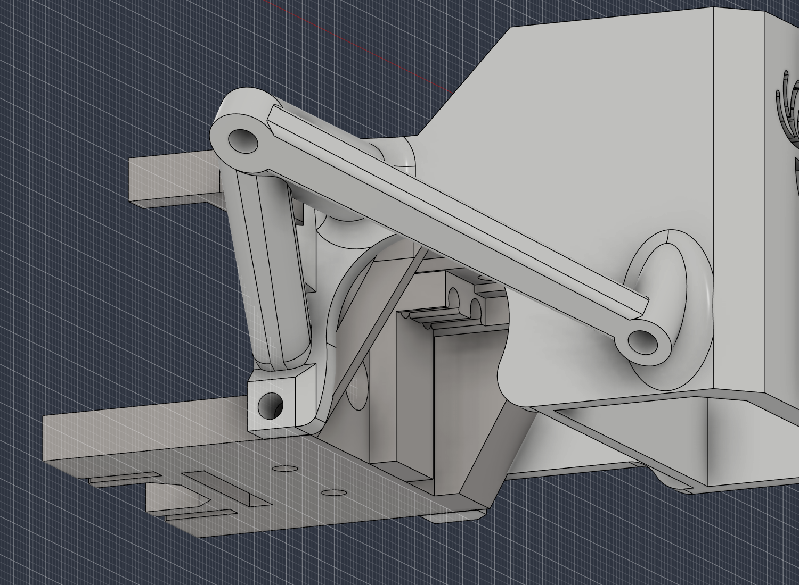
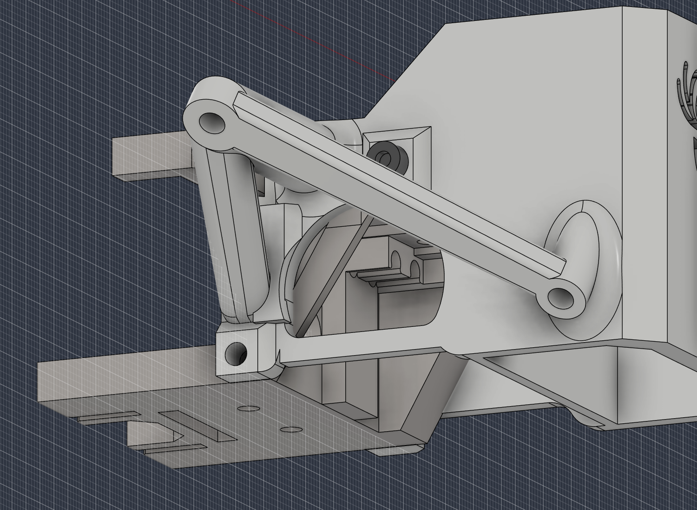
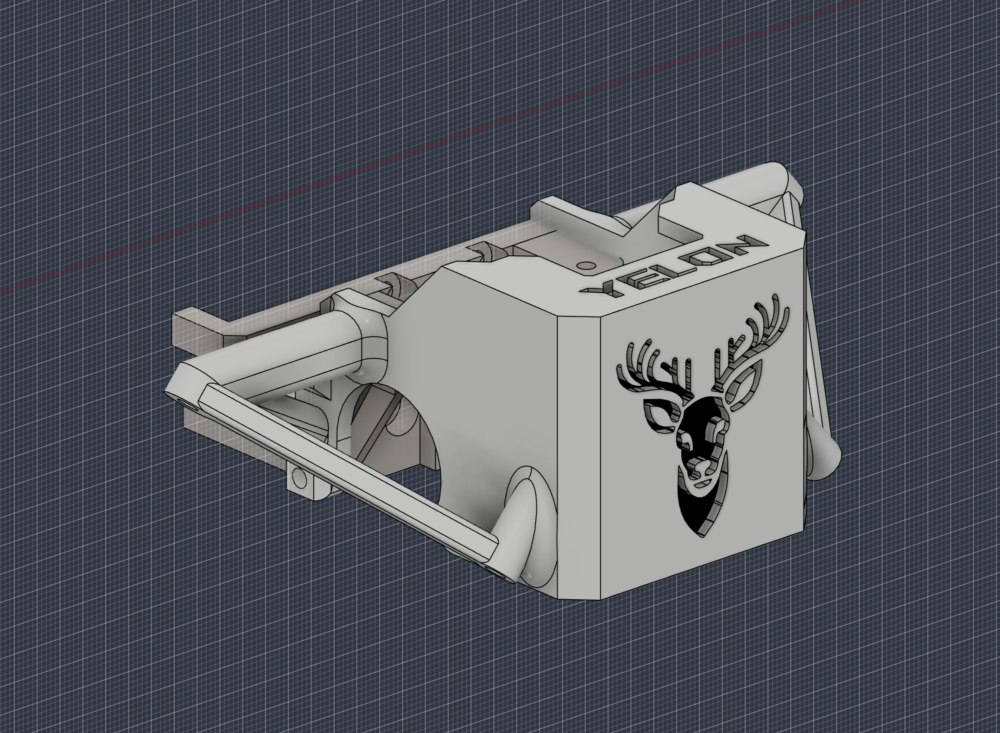
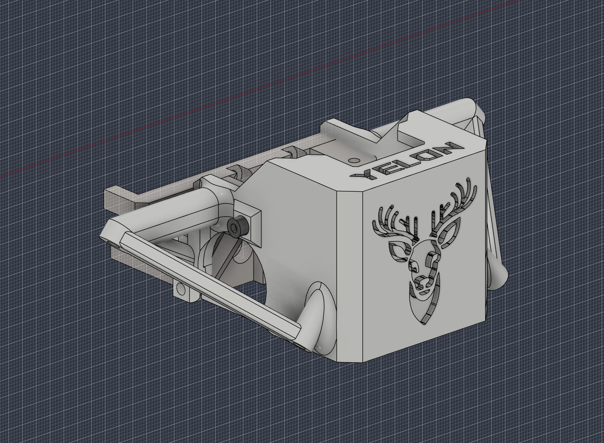

# Cover stiffening study

The [vibration study](vibration-fea.md) found the original design's weak point:
- the hotend cover, which carries the BLTouch and both 5015 fan arms, rocks on its four M3 screws to the carriage body;
- the first "fan" mode is at **135 Hz** (ASA, real hardware masses), at the edge of Klipper's default test band;
- the ADXL sees it at 33 % of the main peak.

This page covers how that was fixed and what the final design achieves.

## Where the cover moves

The mode shape of the 139 Hz mode (ASA, lumped hardware) was examined relative to the body.

- The cover's motion relative to the body grows towards the **front**. It starts at the rear screws (Y = +1.75 mm) and peaks about 20 mm in front of them.
- **Strain hot spot:** the "neck" of the right cover wall, between the rear screw and the arch of the hotend-fan intake opening (the opening is open towards the bottom).
- **A left-right cross brace was considered and rejected.** The axial relative motion between the two sides is only 3–10 % of the motion, so a tie across would carry almost nothing.

## Options

Both options follow the existing style of the part:
- blocks standing 2 mm proud with 2 mm 45° chamfers;
- Ø3.5 clearance holes;
- screw heads on flat faces.

| Option | What it adds |
|---|---|
| **1: front screws** | One extra M3×10 screw per side, cover→body, along X at the **front** of the cover (Y −23.25, Z 25.6). The body's chamfered shelf corners are filled with blocks carrying an M3×5.7 heat-set insert. A matching boss is added on the cover wall |
| **2: closed window + strip** | In the right cover wall, a bridge (R2.5 fillets) closes the bottom of the arch-shaped opening of the hotend-fan intake. A 2 mm strip along the neck joins the two rear screw blocks on that side |
| **1+2** | Both |

| Before | After (1+2) |
|---|---|
|  |  |
|  |  |

## Results

Same model as in the [vibration study](vibration-fea.md): 4 perimeters, 15 % infill, joints by screws only.

| Variant | Main X (belt) [Hz] | **First fan mode [Hz]** | Next modes [Hz] | That mode in ADXL X (rel. to main peak) | Moving mass [g] |
|---|---|---|---|---|---|
| *Lumped 20 g hardware* | | | | | |
| ASA, original | 73.0 | **139** | 156, 191 | 29 % | 331 |
| ASA, option 1 | 75.3 | **153** | 199, 208 | 12 % | 335 |
| ASA, option 2 | 73.3 | **149** | 162, 196 | 43 % | 332 |
| ASA, options 1+2 | 75.3 | **161** | 201, 209 | 11 % | 335 |
| ASA-CF, original | 74.5 | **158** | 179, 209 | 14 % | 335 |
| ASA-CF, options 1+2 | 75.8 | **172** | 215, 217 | 11 % | 339 |
| *Every screw, nut and insert modelled (+8 g cables)* | | | | | |
| ASA, original | 71.2 | **135** | 152, 188 | 33 % | 349 |
| ASA, options 1+2 | 73.5 | **157** | 196, 208 | 11 % | 353 |
| ASA-CF, options 1+2 | 73.9 | **169** | 214, 216 | 11 % | 357 |
| **ASA, FINAL** (1+2, thick duct ears + diagonals) | 73.1 | **156** | 195, 208 | 11 % | 357 |
| **ASA-CF, FINAL** | 73.5 | **168** | 213, 216 | 11 % | 361 |

What this means:
1. **Option 1 does most of the work.**
   - Screwing the cover to the body at the front removes the rocking about the rear screws: +14 Hz on its own.
   - It also cuts the peak the ADXL sees from 29 % to 12 %.
2. **Option 2 alone raises the frequency, but makes the peak more visible** (43 %): the mode changes shape. Together with option 1 it adds a few more Hz.
3. **Options 1+2:** **+22 Hz in ASA** (135 → 157 Hz with real hardware), out of the test band with a margin, and 3× smaller in the ADXL response.
   - ASA-CF on top gives another +12 Hz.
   - The main belt mode even rises by about 2 Hz: the head moves more as one unit, which outweighs the 4 g of extra mass.
4. **Final design (with the thicker duct ears and diagonals):**
   - About 1 Hz lower than 1+2 alone, which is the effect of the duct mass (+2 g per duct).
   - The ducts carry under 1 % of the strain energy, so the ears and diagonals are there for screw clamping, strength and looks, not stiffness.
5. **The weak spot moves.**
   - In the final design the first fan mode is mostly the Orbiter and the right fan moving together.
   - The deformation is in the carriage body (23 % of strain energy), the cover (15 %) and the fan housing (10 %).
   - About half the strain energy is in the belt, rail and carriage springs. So beyond this point, the X carriage, the rail and the belt matter more than the printed parts.
   - This conclusion depends on the **assumed** rail and carriage stiffness (50 N/µm, 1–5 Nm/mrad), which was not measured. A softer real rail would lower this mode.

### Final design, energy split of the first fan mode (ASA, 156 Hz)

| What moves (kinetic energy) | What bends (strain energy) |
|---|---|
| Orbiter 29 %, right 5015 rotor 25 %, cover 15 %, BLTouch 8 %, left rotor 6 % | carriage body 23 %, cover 15 %, right fan housing 10 %, belt / rail / carriage mounting springs ≈ 48 % |

## Caveats

- **Geometry used in the final runs:**
  - The final runs used body and cover meshes from the 1+2 stiffening geometry, plus the final ducts.
  - The heat-set insert holes were deepened **after** these runs (see [design-changes.md](design-changes.md)). That removes a few mm³ next to each insert. The effect on the modes is expected to be negligible, but it was not re-run.
- All the caveats of the [vibration model](vibration-fea.md#what-the-model-does-not-know) apply: no preload or friction, no heat, in-plane moduli, assumed fan mass, belt, rail and damping.
- Not yet measured on a printer.
