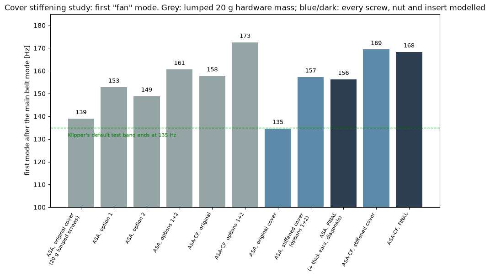

# Cover stiffening

The stock cover rocks on its four rear M3 screws, so its front moves most. Two additions fix that:

- **Option 1:** an extra M3×10 screw and insert on each side at the **front** of the cover, in new blocks on the body.
- **Option 2:** the hotend-fan intake arch in the right wall is closed by a bridge, plus a 2 mm strip along it.

| Before | After |
|---|---|
|  |  |
|  |  |

All screws, nuts and inserts are modelled:

| ASA unless stated | Main X | **First fan mode** | In ADXL | Mass |
|---|---|---|---|---|
| Stock | 71.2 Hz | **135 Hz** | 33 % | 349 g |
| Options 1+2 | 73.5 Hz | **157 Hz** | 11 % | 353 g |
| **Final** (+ thick duct ears, diagonals) | 73.1 Hz | **156 Hz** | 11 % | 357 g |
| Final, ASA-CF | 73.5 Hz | **168 Hz** | 11 % | 361 g |

- **Option 1 does most of the work:** +14 Hz on its own. Option 2 alone raises the frequency but makes the peak more visible.
- **The duct ears and diagonals** are for clamping and looks. They carry under 1 % of the strain.
- **Where the limit moves:** in the final design the Orbiter, the body and the rail/belt springs set the first fan mode. This rests on the assumed rail stiffness.
