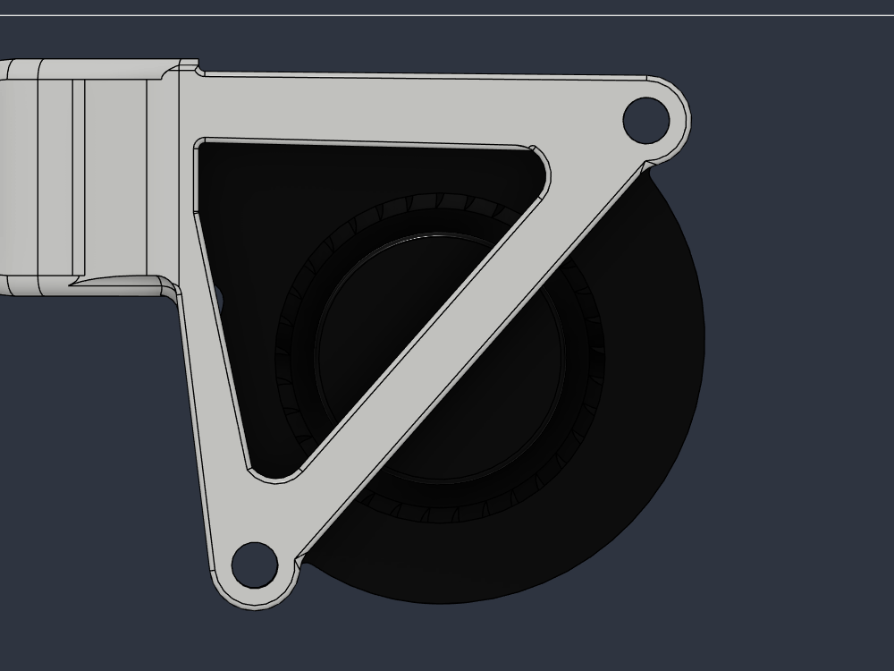
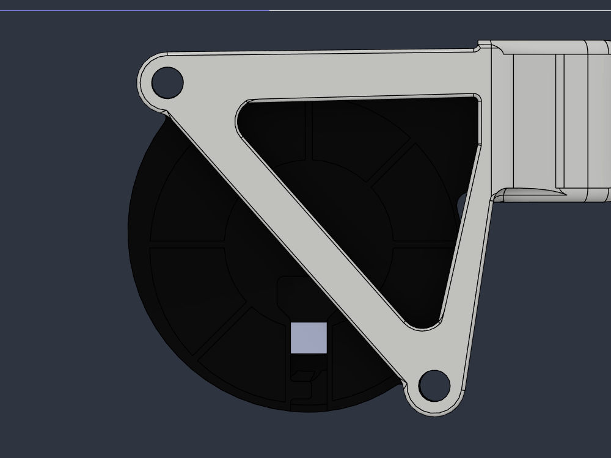
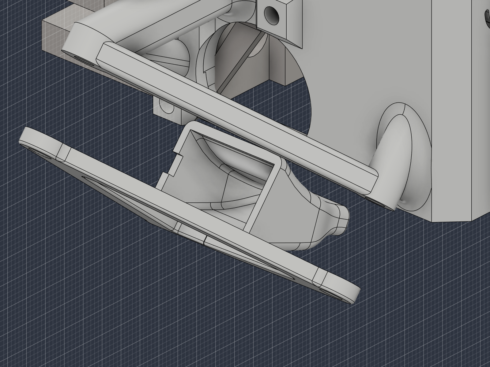

# Changes against the stock toolhead

1. **a10 duct outlets:** aimed snout. See [airflow-cfd.md](airflow-cfd.md).
2. **Ducts screwed to the fans:**
   - two 3.2 mm ears per duct sit on the fan's own screws (M3×22 into inserts), replacing press fit + glue;
   - an ear-to-ear diagonal on each duct.
3. **Cover stiffening:** two front screws, a closed intake arch and a strip. See [cover-stiffening.md](cover-stiffening.md).
4. **Insert holes deepened** to 6.5 mm for M3×5.7 inserts (they were 4.4–5.5 mm). Ream them to Ø4.0 if your inserts need it.

| Right duct | Left duct |
|---|---|
|  |  |

Notes:
- The right diagonal covers about 24 % of the right fan's inlet.
- With ears, the ducts can't be printed outlet-down any more. Pick an orientation with supports and keep the inside of the channel clean.
- The left fan sits about 0.6 mm off the cover holes. The screw still passes through.
