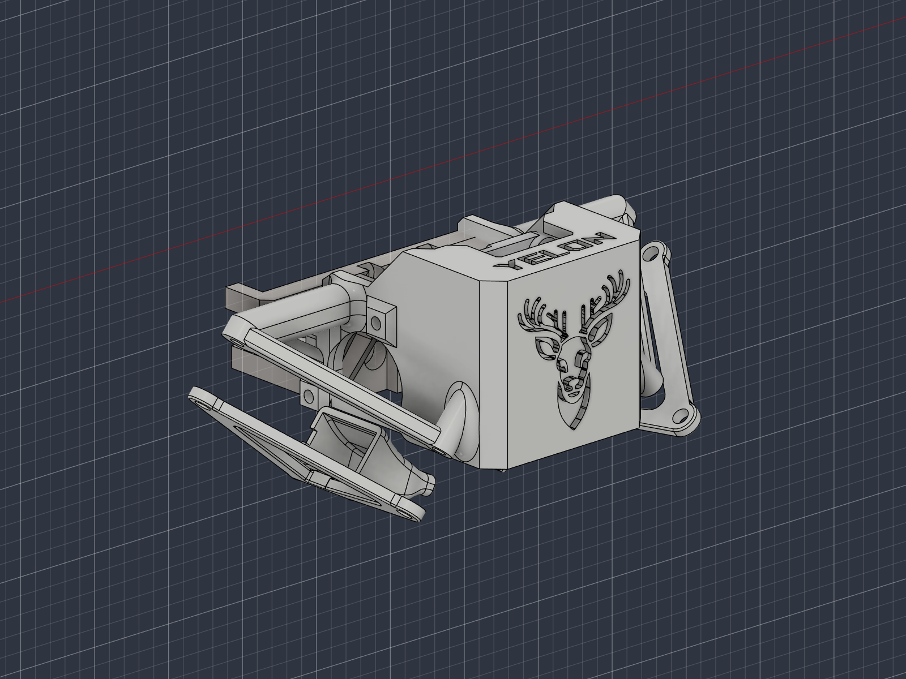
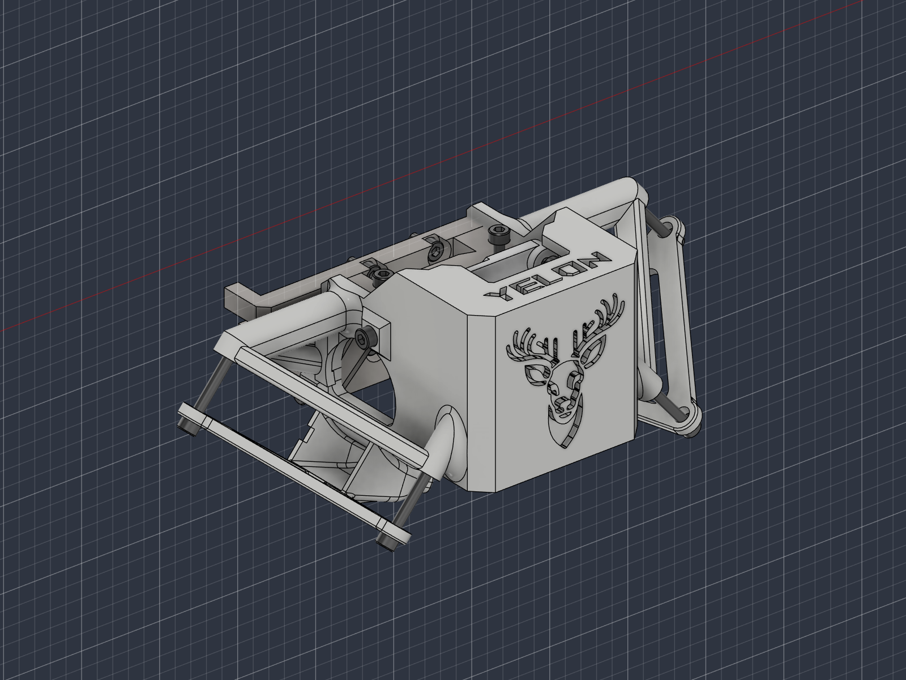

# Design changes against the original toolhead

All changes were made as new features at the end of the Fusion 360 history of the original design. The design was not rebuilt.

| # | Change | Why | Details |
|---|---|---|---|
| 1 | **a10 duct outlets** (aimed snout) | Cooling at the nozzle; no jet on the silicone sock | [airflow-cfd.md](airflow-cfd.md) |
| 2 | **Ducts screwed to the fans** (ears) | Repeatable aim (a10 aims within about 0.5 mm); replaces press fit + hot glue | below |
| 3 | **Thicker ears + ear-to-ear diagonals** | Clamp stiffness, strength, symmetric look | below |
| 4 | **Cover stiffening** (front screws, closed window, strip) | First fan mode 135 → 156 Hz (ASA) | [cover-stiffening.md](cover-stiffening.md) |
| 5 | **Deeper heat-set insert holes** | Original holes were too shallow for M3×5.7 inserts | below |

## 2–3. Duct mounting ears and diagonals

**Original:** the duct was pushed onto the 5015 outlet and secured with a little hot glue. The fan's two M3 screws went through
printed spacers ("5015 caps") into the cover's fan sleeves.

**Now:**
- **Ears.** Each duct has two flat ears, one to each fan screw. The ear sleeves replace the spacers, so the same screw clamps the fan and the duct.
- **Ear thickness.** The ears and the outer wall of the duct sleeve form one flat face, thickened from 1.6 to **3.2 mm**. A wedge with R6 blends run the thickening onto the sloping duct wall, so nothing ends abruptly.
- **Diagonal.** A 6 mm diagonal brace joins the two ears of each duct on the screw-head side. Its fillets are R0.5 on the outline and R3 where it meets the ear rings, and its clearance holes are Ø4.8 over the Ø4.5 ear holes.
- **Fan screws.** M3×22 socket head, no washer, into M3×5.7 heat-set inserts in the cover sleeves.

| Right duct | Left duct |
|---|---|
|  |  |

Notes:
- **Right fan inlet.** The right fan's inlet faces the ears, so the right diagonal covers about 24 % of it. The left fan has a closed back on that side. The CFD did **not** include this (the fan is a fixed-flow source).
- **Left duct offset.** The left fan and duct sit about 0.6 mm off the cover's insert holes; the right side is exact. An M3 screw still passes through the Ø4.5 ear hole (0.75 mm radial clearance).
- **Duct press fit.** The duct still overlaps the fan outlet slightly (5–9 mm³ of overlap in CAD). That is the original press fit.
- **Print orientation is not settled.**
  - The original duct printed with the outlet sleeve on the bed. With ears, that is no longer possible.
  - Measured on the two-ear version before thickening: ears on the bed give about 1100 mm² of overhang (half of it inside the channel); the side face on the bed gives about 400 mm².
  - Check supports in your slicer. The inside of the channel should stay smooth.
- **Strength, not stiffness.** In the vibration model, the ducts carry under 1 % of the strain energy, so ears and diagonals do not change the vibration results (about −1 Hz from their mass).

## 4. Cover stiffening

See [cover-stiffening.md](cover-stiffening.md). The changes are:
- two new blocks and M3×10 screws at the front of the cover;
- a bridge closing the hotend-fan intake arch;
- a 2 mm strip on the right side.

## 5. Heat-set insert holes

The design uses M3×5.7 heat-set inserts. Eight of the original insert holes were only 4.4–5.5 mm deep:
- the four fan-sleeve holes in the cover;
- three cover-to-body holes, which sit in the carriage body;
- the toolboard-mount hole, also in the body.

They were deepened to **6.5 mm** from the insert seat with the same diameter: Ø3.8–3.9 mm (original) and Ø4.0 mm (toolboard mount).
- At least 2.8 mm of material remains behind each bottom.
- The walls around the holes are 1.0–1.8 mm.

Check the hole diameter your inserts need. Many M3×5.7 inserts want Ø4.0–4.2 mm, and the original holes can be reamed to Ø4.0.
