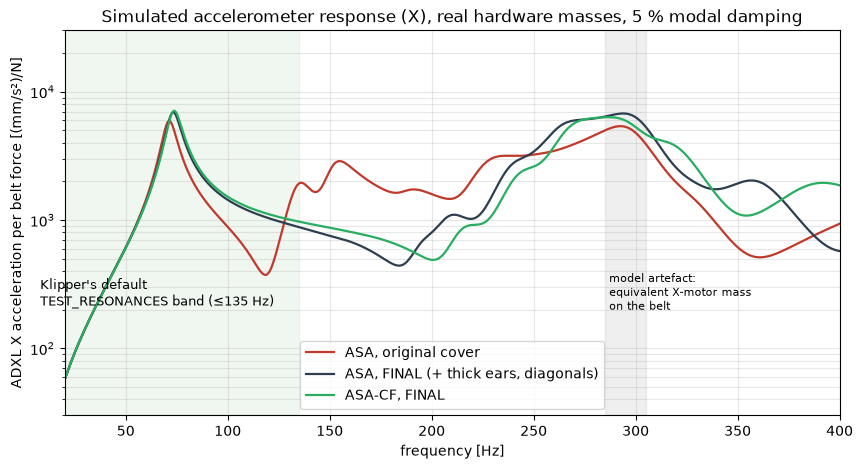
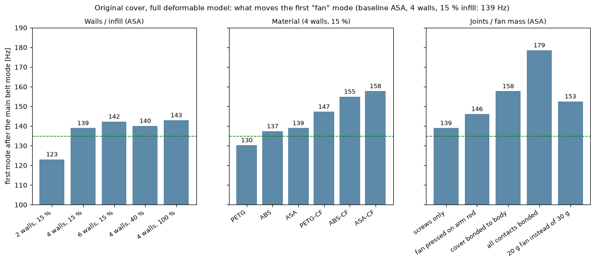

# Vibration (modal FEA)

**What Klipper's ADXL sees on this head, and what limits it.**

- **Main mode, about 73 Hz:** the whole head moves on the belt. This is what input shaping targets. It hardly depends on material.
- **First fan mode, stock design:** **135 Hz** (ASA), 33 % of the main peak in the ADXL. The cover rocks on its 4 screws to the body, carrying the fans with it. The fan arms themselves are not the weak point.
- **First fan mode, final design:** **156 Hz** in ASA and **168 Hz** in ASA-CF, 11 % of the main peak. See [cover-stiffening.md](cover-stiffening.md).

## What matters (stock cover, ASA)

- **Perimeters, not infill.**
  - 2 perimeters give 123 Hz, inside Klipper's test band.
  - 4 perimeters give 139 Hz.
  - 100 % infill gives only 143 Hz.
- **Material:** PETG 130, ABS 137, ASA 139, ABS-CF 155, ASA-CF 158 Hz.
- **The cover-to-body joint is the biggest lever.** Bonding it gives +19 Hz, which led to the stiffening.
- **Fan mass:** a 20 g fan instead of 30 g gives +14 Hz.
- **Fan imbalance** shakes the whole head on the belt: about 90–100 µm/N at the 73 Hz mode, which the rotor reaches at about 4400 rpm. A stiffer arm does not help; a balanced fan does.

## Model

- **Deformable parts:** about 500k-node C3D10 mesh (gmsh + CalculiX) of every printed part and both housings of each 5015.
- **Rigid bodies:** the Orbiter (124 g), hotend (35 g), BLTouch, ADXL, PCB and the 5015 rotors, with real masses and inertia.
- **Joints:** every screw is a rigid spider joining only the parts it clamps; every screw, nut and insert carries its mass.
- **Printed material:** skin of perimeters × 0.45 mm plus infill.
- **Mounting:** the MGN12H on springs; the belt at 150 N/mm; 5 % damping.

## Limitations

- Joint preload and friction are not modelled. "Screws only" and "all bonded" (139 vs 178 Hz) bracket the truth.
- No heat and no layer anisotropy.
- Fan mass (30 g), belt and rail stiffness, and belt clamp location are assumed.
- The peak at about 296 Hz in the plots is a model artefact (the equivalent motor mass).
- Not measured yet. Check it with `TEST_RESONANCES AXIS=X FREQ_END=250`.
