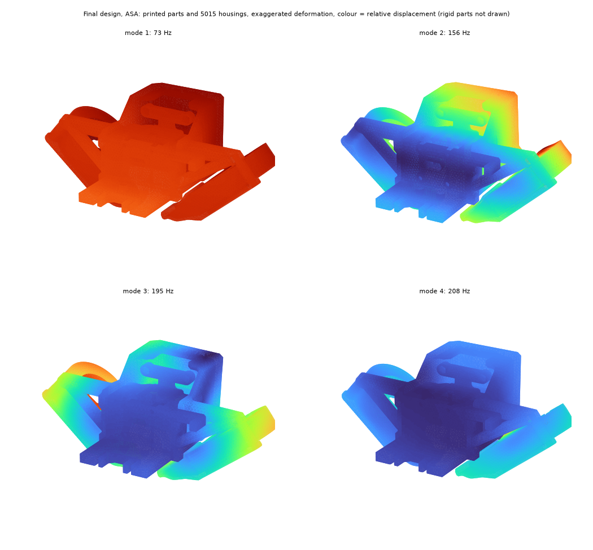

# Vibration (modal FEA) and input shaping

**Goal:** find out what an accelerometer on this toolhead sees during Klipper's `TEST_RESONANCES AXIS=X`, and which part of the
structure limits it. The A10M is a bed-slinger, so only the X axis carries the toolhead.

The original design was the starting point. The 5015 fans on their long arms were the suspected problem. This page describes the
model and the parameter studies. The stiffening changes that came out of it are in [cover-stiffening.md](cover-stiffening.md).

## Summary

- **Main mode, about 71–76 Hz:** the whole toolhead moves in X on the belt. This is the peak Klipper measures and shapes. It
  depends on belt stiffness and total mass, hardly on the printed material (±2 Hz across all materials).
- **First "fan" mode** of the original design: **135 Hz in ASA** with every screw modelled.
  - In this mode the right 5015 rotor and housing rock together with the cover. The ADXL sees it at about 30 % of the main peak.
  - **The cover's joint to the carriage body bends** (about 55 % of the strain energy), not the fan-arm struts.
  - The mode sits right at the edge of Klipper's default test band (5–135 Hz).
- **Final design** (stiffened cover plus thick duct ears and diagonals):
  - first fan mode **156 Hz in ASA** and **168 Hz in ASA-CF**;
  - ADXL sees it at 11 % of the main peak;
  - +8 g of moving mass.
- **Print settings:** perimeter count matters far more than infill. Two perimeters drop the fan mode into the test band; 4 or more are needed.
- **Material:** PETG is the worst choice (it is the softest, the heaviest and the most heat-sensitive). The CF grades add 10–20 Hz.




## Model

The model is "v2"; an earlier, simpler model was discarded (see the end of this page).

### Deformable parts (FE, quadratic tetrahedra C3D10, about 500k nodes)

Each part was meshed separately in gmsh from the Fusion export:
- carriage body;
- hotend cover with the fan arms;
- toolhead-board mount;
- both ducts;
- **both housings of each 5015 fan**, in PBT (E = 2500 MPa).

### Rigid bodies with real mass and inertia

Inertia comes from the CAD geometry, scaled to the stated mass. Each rigid body is attached **only through its screws**.

| Component | Mass |
|---|---|
| Orbiter v2.0 + LDO 36STH17 motor | 124 g |
| Hotend incl. its 25 mm fan | 35 g |
| BLTouch | 10 g |
| ADXL345 board | 3 g |
| Toolhead PCB | 6 g |
| Rotor + motor of each 5015 (on its hub in the housing) | 22 g |

A 5015 is assumed to weigh 30 g in total: 8 g of housing and 22 g of rotor and motor.

### Joints

| Joint | How it is modelled |
|---|---|
| Screws | Rigid "spiders" tying the hole wall and the clamped annulus under the head or nut, in every part the screw passes through. Covered: cover↔body (4× M3, 6× in the stiffened design), fans and ducts onto the cover sleeves, Orbiter, hotend, BLTouch, ADXL, PCB, PCB mount |
| 5015 housing halves | Tied along their seam, as in a real fan |
| Duct on the fan outlet | Tied (press fit) |
| Rail | MGN12H carriage footprint (45.4 × 27 mm) is one rigid body (50 g) on springs: 50 N/µm translational, 1–5 Nm/mrad rotational. Free in X |
| Belt | 150 N/mm spring from the belt clamp to an equivalent X-motor mass (130 g), motor mount 300 N/mm. **Assumed** clamp location: the lower "tongue" of the body behind the rail (Y > 25 mm, Z 48.5–55.5 mm) |
| Upper bound variant | `bonded`: every touching surface glued |

### Printed material

| Material | E in the layer plane (from manufacturer TDS) [MPa] | Density [g/cm³] |
|---|---|---|
| ABS | 2200 | 1.04 |
| ASA | 2300 | 1.07 |
| PETG | 2000 | 1.27 |
| ABS-CF | 3400 | 1.10 |
| ASA-CF | 3700 | 1.12 |
| PETG-CF | 3000 | 1.29 |

- A solid skin of `perimeters × 0.45 mm` (0.4 mm nozzle) is assigned element by element, by depth below the surface.
- The core gets infill φ with `E·φ^1.5` and `ρ·φ`.
- Hardware mass is handled in two ways:
  - **"Lumped":** 20 g for screws and cables, smeared over the body and cover;
  - **"Real hardware masses":** every M3 screw, nut and heat-set insert from the Fusion model (about 36 g) as point masses on its spider, plus 8 g of cables.

### Solution

- CalculiX 2.20, `*FREQUENCY`, 40 modes, units mm-g-ms-N.
- The frequency response (FRF) comes from modal superposition with 5 % modal damping:
  - **Klipper-like:** a force at the belt, giving acceleration at the ADXL and at the nozzle;
  - **fan imbalance:** a rotating 1 N force at each rotor.
- For each mode, the kinetic energy (what moves) and the strain energy (what bends) are split by part.
  - The strain energy is computed both by CalculiX and by a separate element-by-element post-processor; the two agree.
  - With the multithreaded SPOOLES solver, a few runs showed local noise at single nodes. Repeat runs reproduced frequencies and shapes within 0.3 %. The noise only affected the "what bends" split, so final runs use the single-threaded equation solver.

## Results: original design (ASA, 4 perimeters, 15 % infill, screws only, lumped hardware)

| Mode | f [Hz] | What moves (kinetic energy) | What bends (strain energy) |
|---|---|---|---|
| 1 | 73 | whole head in X on the belt: Orbiter 26 %, cover 18 %, rail block 10 %, each 5015 rotor 8 %, hotend 7 % | mostly the belt / rail springs (printed parts: cover 9 %, body 4 %) |
| 2 | **139** | right 5015 rotor 34 %, cover 21 %, Orbiter 11 %, BLTouch 8 %, left rotor 7 % | **cover 54 %**, right fan housing 10 %, body 6 % |
| 3 | 156 | right rotor 29 %, cover 18 %, Orbiter 15 %, left rotor 12 % | cover 48 %, right fan housing 12 %, body 11 % |
| 4 | 191 | Orbiter 37 %, right rotor 29 %, left rotor 17 % | body 29 %, cover 20 %, right fan housing 20 % |
| 5–8 | 220–247 | 5015 rotors rocking on their hubs (one side or both), partly with the Orbiter or the BLTouch | fan housings, then cover and body |

Kinetic energy shares under 4 % and strain shares under 3 % are not listed. Where the strain shares add up to less than 100 %, the
rest is in the belt, rail and motor springs.

With real hardware masses, the original design drops to **71.2 / 135 / 152 Hz**, and the second peak reaches 33 % of the main
peak in the ADXL X response.

**The weak point is where the cover joins the carriage body.** The cover, the fan arms and the fans rock as one unit about the
cover's four M3 screws. The highest strain is around the screw nearest the right fan. The fan-arm struts themselves are not the
problem.

### Parameter studies (original cover, ASA unless stated)


| Change | First fan mode | Main X mode |
|---|---|---|
| Baseline: 4 perimeters, 15 % infill | 139 Hz | 73.0 Hz |
| 2 perimeters | **123 Hz** (inside the test band; ADXL sees it at about 50 % of the main peak). Probably a lower bound, since 0.9 mm of skin is less than one element | 72.5 Hz |
| 6 perimeters | 142 Hz | 71.4 Hz |
| 40 % / 100 % infill | 140 / 143 Hz | 72.8 / 72.3 Hz |
| PETG / ABS / ASA | 130 / 137 / 139 Hz | 70.8 / 73.1 / 73.0 Hz |
| PETG-CF / ABS-CF / ASA-CF | 147 / 155 / 158 Hz | 72.6 / 74.1 / 74.5 Hz |
| Fan pressed onto the arm strut, duct onto the fan face | 146 Hz | 73.3 Hz |
| **Cover bonded to the body over the full contact** | **158 Hz** | 75.2 Hz |
| All contacts bonded (upper bound of the model) | 178 Hz | 75.6 Hz |
| 20 g fan instead of 30 g | 153 Hz | 75.9 Hz |

What this means:
1. **Perimeters, not infill.**
   - The arms, struts and cover walls are thin, so they are almost entirely perimeters.
   - Use at least 4 perimeters; 2 is clearly too few.
2. **Material.**
   - PETG is the worst: it is the softest and the heaviest, and it softens near the hotend (heat is not modelled).
   - ABS ≈ ASA.
   - CF grades add 10–20 Hz, but need a hardened nozzle.
   - All moduli are in-plane. Between layers every material is weaker, and CF hardly helps there, so print orientation matters.
3. **The cover-to-body joint is the biggest design lever.**
   - Bonding the full contact gives +19 Hz, as much as switching ASA → ASA-CF.
   - This led directly to the [cover stiffening study](cover-stiffening.md).
4. **A lighter fan helps** (30 g → 20 g: +14 Hz). Weigh your fans.

### Fan imbalance

A rotating 1 N imbalance at either fan rotor shakes the **whole head on the belt**. The X amplitude at the nozzle peaks at the main
mode:
- about 100 µm/N at 71–73 Hz for the original design;
- 87 µm/N for the final design;
- 13–47 µm/N between 80 and 110 Hz.

The stiffening hardly changes this, because the response is the belt mode, not the arms.
- The rotor crosses 73 Hz at about 4400 rpm, which a 5015 reaches at partial PWM.
- Some part-fan setting will therefore excite the main mode.
- A balanced fan, or avoiding that fan speed, is the fix. A stiffer arm does not help.

## What the model does not know

The truth lies between "screws only" and "everything bonded".
- **Joints:** screw preload and friction at contact faces are not modelled. For the original ASA design, the first fan mode is 139 Hz with screws only and 178 Hz with everything bonded.
- **Heat:** heat from the hotend is not modelled. PETG and, to a lesser extent, ABS/ASA soften next to the cover.
- **Layers:** layer anisotropy is not modelled (in-plane moduli are used everywhere).
- **Assumed inputs:**
  - fan mass 30 g; ±10 g moves the fan mode by about 14 Hz;
  - damping 5 %;
  - belt 150 N/mm (in the earlier model, 80 / 240 N/mm moved the main mode by −14 / +9 Hz);
  - rail and carriage stiffness (the springs above, not measured);
  - where the belt is clamped.
- **About 296 Hz in the ADXL response:** this is the equivalent X-motor mass on the belt spring, not the toolhead. It is a model artefact, marked in the plots.
- **Screw spiders:** strain concentrates at the edge of each rigid spider. The reliable conclusion is that the cover bends around its screws, not the exact hot spot.
- **Measurement:** nothing here has been measured yet.

## How to check it on the printer

```
TEST_RESONANCES AXIS=X FREQ_END=250
```

- The model predicts a second peak at about 125–180 Hz, at 10–40 % of the main peak, depending on material and joint stiffness.
- The default `FREQ_END` (135 Hz) cuts it off.
- Also weigh one 5015.
- Run `MEASURE_AXES_NOISE` with the part fan off and at `M106 S128 / S180 / S255`. A large noise increase with the fan on means an unbalanced rotor.

## Earlier model (discarded)

The first model glued each fan with its duct, as one rigid mass, to every carriage node within 0.5–3 mm. This made the fans act as
stiffeners of the arms, so it was too stiff. A follow-up with springs at the fan screws showed the fan rocking mode is controlled
almost entirely by how stiff the fan's screw clamp is.

Both were replaced by the v2 model above, in which all fan housings and printed parts deform.

## Files

- `results/fea/`:
  - `figures_data.json` (all numbers on this page);
  - per-run `summary.json` (modes, probe shapes, FRFs) and `energy.json` (energy split per part) for the runs used here.

The raw runs, the meshes and the scripts are not in the repository.
